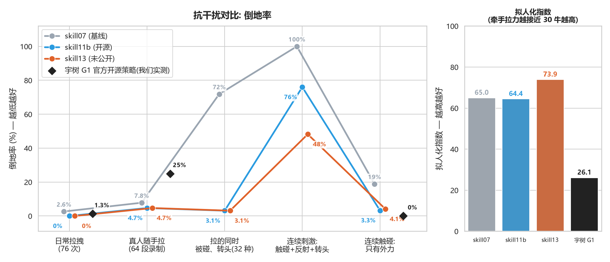
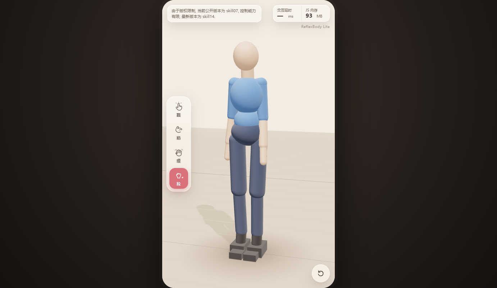

# 流明 Lumen · 虚拟角色研究公开版

各位路过的朋友们、未来的博士、院士、社会精英们点个star吧，球球了！

武汉光影流明科技有限公司的虚拟具身智能研究公开版本. 我们想做一个能听懂话、动作自然、被触碰时会像真人一样反应的虚拟角色.
这个仓库按版本存放已经公开的部分, 每个版本在自己的文件夹里, 有独立的说明、运行方式和许可.


## 版本一览

| 版本 | 一句话 | 运行环境 | 文件夹 |
|---|---|---|---|
| **ReflexBody skill11b** | 具身智能交互仿真: 按住人形机器人身体任意部位拉动, 它在物理仿真中自己保持平衡 | 任意现代浏览器, 手机可用, 纯静态网页 | [ReflexBody/](ReflexBody/) |
| **ReflexBody skill07** | 同一系统的基线版, 适合做对照、训练与蒸馏研究 | 同上 | [ReflexBody/skill07/](ReflexBody/skill07/) |
| **HAST-SEC v0.1** | 中文聊天驱动的角色动作控制, 运动学层: 自然待机、行走与局部动作 | Windows + Node.js 22, 本地中文小模型 | [v0.1/](v0.1/) |

## 👾在线体验👾: [skill11b 展台](https://sola1039.github.io/HAST-SEC/ReflexBody/) · [skill07 基线](https://sola1039.github.io/HAST-SEC/ReflexBody/skill07/) (电脑和手机都可以直接打开)

## ReflexBody 抗干扰能力



| 测试(倒地率, 越低越好) | skill07 基线 | skill11b 开源 | skill13 未公开 | 宇树 G1 官方开源策略(我们实测) |
|---|---|---|---|---|
| 日常拉拽(76 次) | 2.6% | **0%** | 0% | 1.3% |
| 真人随手拉(64 段真实操作录制) | 7.8% | **4.7%** | 4.7% | 25% |
| 拉的同时被碰、转头(32 种情况) | 72% | **3.1%** | 3.1% | 不适用 |
| 连续刺激: 触碰 + 反射 + 转头(30 秒内倒地) | 100% | **76%** | 48% | 不适用 |
| 连续触碰: 只有外力(30 秒内倒地) | 19% | **3.3%** | 4.1% | 0% |
| 拟人化指数 | 65.0 | **64.4** | 73.9 | 26.1 |

- **日常拉拽**: 牵着手往各个方向走, 或随手拖手、胸口、头; **真人随手拉**: 回放真人在网页上的真实拖拽, 包括猛拽.
- **拉的同时被碰、转头**: 被戳、被掐、被摸, 同时头转过去看、手臂和躯干本能地躲开; **连续刺激**: 每隔零点几秒就来一次触碰、反射或转头, 持续 30 秒; **连续触碰**: 同样的节奏, 但只有外来的触碰力, 没有反射和转头.
- **拟人化指数**: 6 次牵手中, 每次手上拉力与 30 牛的差距取平均, 指数 = 100 × (1 − 平均差距 ÷ 30); 越接近 30 牛, 被牵着时越像真人那样顺着走.
- **宇树 G1**: 宇树官方开源的 G1 运动策略(unitree_rl_gym, 12 自由度模型, 上身固定), 由我们放在同样的仿真测试里实测: 同样的手指拉力、同样的拖拽与触碰、同样的倒地判定, 地面摩擦与我们相同(0.5). G1 没有反射层, 头也不能转, 所以第三、四项不适用. 结果: 对零碎触碰非常稳(0%), 但遇到真人那样大幅度、持续的拖拽时有四分之一会倒, 被牵着走时手上拉力在 44-57 牛, 更像被拖着走.
- 每一代的进步: skill07 → skill11b 学会了在被碰、转头时站稳(72% → 3%); skill11b → skill13 扛住连续刺激的能力明显提升(76% → 48%).

---

## ReflexBody: 可以拉动的人形机器人



机器人的身体是一个真实的物理模型: 21 个体段、44 个关节伺服、45 千克, 在 MuJoCo 物理引擎里以 5 毫秒一步运行.
你拉它的手、腰或头, 力直接作用在身体上; 它每 20 毫秒调整一次全身关节, 顶住、挪步或顺着拉力, 尽量不倒.
整个过程在浏览器本地实时运行, 不需要显卡和服务器算力.

**快速开始**

- 在线: 打开上面的链接.
- 本地: 克隆仓库后进入 `ReflexBody/`, Windows 双击 `start.bat`; 其他系统运行 `node serve.mjs`, 打开 http://127.0.0.1:8860/ (需要 Node.js 18+).
- 手机: `node serve.mjs --lan`, 手机连同一 Wi-Fi 打开命令行打印的地址.
- 部署到自己的网站: 整个文件夹是静态网页, 放到 GitHub Pages、Netlify、对象存储等任何静态托管即可. 详见 [ReflexBody/README.md](ReflexBody/README.md).

**两个开源版本**

- **skill11b**(`ReflexBody/`): 受拉更稳, 练过上半身受干扰, 更适合拿来跑交互.
- **skill07**(`ReflexBody/skill07/`): 早期基线版, 更适合做对照研究.
- 两个版本都允许非商业的训练、微调与蒸馏, 由此得到的模型也禁止商用.
- 最新版本 skill14 由于版权限制暂不公开.

**本版边界**

- 只支持"拉动". 展台左侧的戳、掐、摸是锁定的.
- 只包含站立受力反应, 不包含被牵着走、摔倒后起身.
- 模型是早期精简版, 不是正式版能力.

---

## HAST-SEC v0.1: 中文控制的角色动作

混合自适应语义时序骨骼控制与估计系统. 在本机用约 0.8B 的中文小模型理解聊天与指令, 驱动 VRM 角色的连续运动、局部动作和表情, 并实时显示运动曲线与资源占用.

**快速开始** (Windows 10/11, Node.js 22+):

```powershell
git clone https://github.com/sola1039/HAST-SEC.git
cd HAST-SEC/v0.1
npm ci
npm run setup      # 没有 NVIDIA 显卡; 有显卡用: powershell -NoProfile -ExecutionPolicy Bypass -File tools/setup.ps1 -Cuda
npm start          # 打开 http://127.0.0.1:8769/language-lab
```

完整说明、角色导入与常见问题见 [v0.1/README.md](v0.1/README.md).

---

## 少量数据, 小算力

整套系统从约 11 分钟的动作素材出发, 训练只用了消费级显卡, 最终只需要浏览器就能运行. 方法细节将随论文发布.

## 完整版能力(未开源)

正式版在此基础上还有:

- 戳、掐、抚摸等触碰, 皮肤感受(触觉、快痛、慢痛), 受刺激后的反射回缩与惊跳, 转头看向被碰的地方;
- 在转头、反射内力和高频连续刺激下仍保持站立;
- 按好感度顺从或抵抗, 被牵着走;
- 摔倒后起身, 行走, 与语言模型和表情联动.

这些交互需要更多的反射层与对应训练的模型, 并涉及第三方素材与角色版权, 因为版权等原因没法开源. 有合作意向欢迎联系.

## 仓库结构

```
HAST-SEC/
├── README.md        本文件
├── docs/images/     首页图片
├── ReflexBody/      ReflexBody skill11b(纯静态网页, 可直接部署)
│   └── skill07/     ReflexBody skill07 基线版
└── v0.1/            HAST-SEC v0.1(Node.js 本地服务)
```

## 许可

两个版本都是**源码可见的非商业版本**, 不允许商业使用:

- ReflexBody skill11b: [ReflexBody/LICENSE](ReflexBody/LICENSE); skill07: [ReflexBody/skill07/LICENSE](ReflexBody/skill07/LICENSE). 两者都允许非商业的训练、微调与蒸馏, 由此得到的模型同样禁止商用.
- HAST-SEC v0.1: [v0.1/LICENSE](v0.1/LICENSE).
- 第三方软件与素材遵循各自许可, 见各文件夹的 `THIRD_PARTY_NOTICES.txt`.

商业授权、技术共研与合作请联系: [zhouzihuai@las-lumen.cn](mailto:zhouzihuai@las-lumen.cn). 问题反馈请提交 [Issues](https://github.com/sola1039/HAST-SEC/issues).

## 关于我们

武汉光影流明科技有限公司专注虚拟具身智能、角色智能与互动内容研发, 探索语言理解、身体表现和互动叙事之间的连接.
我们正在寻求技术共研、应用落地、内容合作与商业授权合作, 同时寻求融资支持.

公司官网: [武汉光影流明科技有限公司](https://47.113.224.57/company/) · 联系: [zhouzihuai@las-lumen.cn](mailto:zhouzihuai@las-lumen.cn)

---

## English summary

Research releases of **Lumen**, an embodied virtual character by 武汉光影流明科技有限公司 (Wuhan, China).

- **ReflexBody** ([ReflexBody/](ReflexBody/), [live demo](https://sola1039.github.io/HAST-SEC/ReflexBody/)): a physics-based humanoid robot in the browser that you can pull by any body part. Two open versions: skill11b (steadier, for interaction) and skill07 ([ReflexBody/skill07/](ReflexBody/skill07/), a baseline). Both licences allow non-commercial training, fine-tuning and distillation; commercial use of the releases or of models derived from them is not allowed. MuJoCo compiled to WebAssembly steps the body every 5 ms and a controller keeps it standing. Runs on phones; no GPU or server needed. These releases support pulling only.
- **HAST-SEC v0.1** ([v0.1/](v0.1/)): Chinese-language control of a VRM character's motion with a small local language model.

The system starts from about eleven minutes of motion capture and was trained on consumer GPUs; details will follow with our paper. Both releases are source-available for **non-commercial use only**. Contact: zhouzihuai@las-lumen.cn
