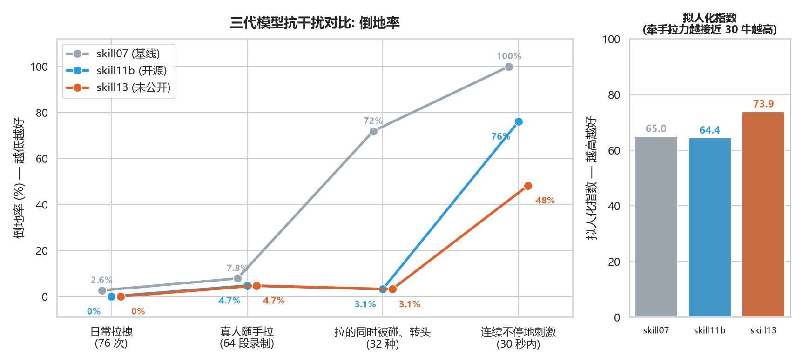

# ReflexBody · 具身智能交互仿真(开源版 skill11b)

在浏览器里拉动一个物理数字人: 按住身体任意部位往任意方向拖, 身体在物理仿真中自己保持平衡、挪步、顶住或顺着拉力.
物理 5 毫秒一步(MuJoCo WebAssembly), 控制器每 20 毫秒运行一次, 全部在本地浏览器里实时运行, 手机也可以.
不需要显卡, 不需要服务端计算, 只需要一个能提供静态文件的地方.

在线体验: https://sola1039.github.io/HAST-SEC/ReflexBody/ (仓库开启 GitHub Pages 后可用)

## 能做什么, 不能做什么

**本版只支持"拉"**: 用手指或鼠标抓住身体任意部位拖动.

本文件夹是开源版 **skill11b**, 展台和调试页都使用它. 展台的机器人外观使用宇树 G1 的公开模型(BSD-3-Clause, 见 THIRD_PARTY_NOTICES.txt), 物理身体与控制由我们自研, 非宇树官方产品. 由于版权限制, 最新版本 skill14 暂不公开.

## 抗干扰能力

| 测试(倒地率, 越低越好) | skill07 基线 | skill11b 开源 | skill13 未公开 |
|---|---|---|---|
| 日常拉拽(76 次) | 2.6% | **0%** | 0% |
| 真人随手拉(64 段真实操作录制) | 7.8% | **4.7%** | 4.7% |
| 拉的同时被碰、转头(32 种情况) | 72% | **3.1%** | 3.1% |
| 连续不停地刺激(30 秒内倒地) | 100% | **76%** | 48% |
| 拟人化指数(牵手时手上拉力越接近 30 牛越高, 满分 100, 越高越好) | 65.0 | **64.4** | 73.9 |

- **日常拉拽**: 牵着手往各个方向走, 或随手拖手、胸口、头; **真人随手拉**: 回放真人在网页上的真实拖拽, 包括猛拽.
- **拉的同时被碰、转头**: 被戳、被掐、被摸, 同时头转过去看、手臂和躯干本能地躲开; **连续不停地刺激**: 每隔零点几秒就来一次触碰或干扰, 持续 30 秒.
- **拟人化指数**: 6 次牵手中, 每次手上拉力与 30 牛的差距取平均, 指数 = 100 × (1 − 平均差距 ÷ 30); 越接近 30 牛, 被牵着时越像真人那样顺着走.
- 每一代的进步: skill07 → skill11b 学会了在被碰、转头时站稳(72% → 3%); skill11b → skill13 扛住连续刺激的能力明显提升(76% → 48%).

## 两个开源版本

| | skill07(`skill07/` 文件夹) | skill11b(本文件夹) |
|---|---|---|
| 定位 | 基线: 早期版本, 结构简单, 适合做对照和二次研究 | 交互: 受拉更稳, 更适合拿来跑交互演示 |
| 抗拉动 | 站得住一般的拉动 | 更稳, 被拉偏后更容易自己站回来 |
| 上半身受干扰(转头、触碰) | 未练过, 容易倒 | 练过, 大多能站住 |
| 许可 | 非商业使用; **允许非商业的训练、微调与蒸馏**, 禁止商用 | 同左: 非商业使用; **允许非商业的训练、微调与蒸馏**, 禁止商用 |

两者都只包含站立受力反应, 只支持拉动.

完整版还有戳、掐、抚摸、转头看向被碰的地方、受刺激后的回缩与惊跳、被牵着走、摔倒后起身、好感度影响顺从程度等交互.
这些交互需要更多的反射层(皮肤感受、脊髓反射、朝向反射等)和对应训练的模型, 因为版权等原因没法开源, 本版不包含.
展台左侧的"戳 / 掐 / 摸"按钮因此是锁定的.

完整版中的角色形象(VRM 模型)属于第三方作品, 许可禁止再分发, 本版用物理胶囊体显示身体.

本版是早期研究演示的精简版, 模型不是正式版能力, 只包含站立受力反应.

## 快速开始(本地电脑)

需要 [Node.js](https://nodejs.org/) 18 或更新版本, 以及现代浏览器(Chrome / Edge / Safari / Firefox 新版).

- Windows: 双击 `start.bat`, 浏览器会自动打开 http://127.0.0.1:8860/
- macOS / Linux: 在本目录运行 `node serve.mjs`, 然后打开 http://127.0.0.1:8860/

首次载入约 45 MB(模型数据). 关闭命令行窗口即停止.

页面:
- `index.html`: 展台(人形机器人, 仿真场景), 适合展示和手机.
- `debug.html`: 调试页, 可调好感度和地面摩擦.
- `skill07/`: 基线版 skill07 的完整页面与模型.

## 在手机上玩(同一 Wi-Fi)

1. 电脑和手机连同一个 Wi-Fi.
2. 在本目录运行 `node serve.mjs --lan`, 命令行会打印 `Phone (same Wi-Fi): http://192.168.x.x:8860/`.
3. 手机浏览器打开这个地址. 如果打不开, 检查电脑防火墙是否允许 Node.js 的入站连接.

## 部署到网上(任何人点链接就能玩)

本目录是纯静态网站, 可以直接放到任何静态托管上, 不需要后端.

### GitHub Pages

本目录在 HAST-SEC 仓库里的发布方式: 仓库 Settings -> Pages, Source 选 "Deploy from a branch", 分支 `main`, 目录 `/ (root)`, 保存后访问 `https://sola1039.github.io/HAST-SEC/ReflexBody/`.

自己部署一份:

1. 把本目录推送到一个 GitHub 仓库(可以是仓库里的子目录).
2. 仓库 Settings -> Pages -> Build and deployment, Source 选 "Deploy from a branch", 选分支和目录(本目录在仓库根目录就选 `/ (root)`).
   如果本目录在子目录里, 可以改用 GitHub Actions 发布该子目录, 或者把本目录单独放一个仓库.
3. 等一两分钟, 打开 `https://<用户名>.github.io/<仓库名>/`(子目录则在后面加子目录路径).

### 其他静态托管

Netlify、Vercel、Cloudflare Pages、对象存储(OSS / COS / S3)加 CDN 都可以. 只需注意:
- 整个目录原样上传, 保持相对路径不变.
- `.wasm` 文件的类型要是 `application/wasm`(主流托管默认如此).
- 必须通过 http(s) 访问, 直接双击打开 html 文件(file://)无法运行.

## 操作

- 按住身体任意部位拖动, 松开即放手; 拖动空白处旋转视角, 双指或滚轮缩放.
- 摔倒后自动恢复站姿; 右下角按钮也可以恢复.
- 右上角显示交互延时和浏览器内存.

## 目录

| 文件或目录 | 内容 |
|---|---|
| `index.html`, `showcase.mjs`, `showcase.css`, `lite.css`, `robot.mjs`, `tether.mjs`, `loading.mjs` | 展台 |
| `debug.html`, `demo.mjs` | 调试页 |
| `runtime/` | 运行时: 控制器、物理封装、绘制、场景 |
| `model/` | 身体物理模型、初始站姿、模型数据(skill11b) |
| `robot/` | 展台的机器人外观(宇树 G1 公开模型换算到身体各体段, BSD-3-Clause) |
| `vendor/` | MuJoCo WebAssembly 与 three.js(第三方, 见 THIRD_PARTY_NOTICES.txt) |
| `serve.mjs`, `start.bat` | 本地静态服务器 |

本版不包含训练代码、训练数据或训练流程.

## 许可

非商业使用许可, 见 [LICENSE](LICENSE). 简要说明(以 LICENSE 原文为准):

- 允许非商业的学习、教学、研究、评测与演示使用, 允许免费分发未经修改的完整副本.
- 禁止任何商业使用; 商业授权请联系 zhouzihuai@las-lumen.cn.
- 允许为非商业目的修改模型数据, 以及用它们或其运行输出训练、微调、蒸馏其他模型; 由此得到的模型可非商业分发, 须注明来源并附带许可证.
- 由此得到的模型同样不得商用.

第三方软件与数据致谢见 [THIRD_PARTY_NOTICES.txt](THIRD_PARTY_NOTICES.txt).

## 关于

武汉光影流明科技有限公司, 专注虚拟具身智能、角色智能与互动内容研发. 合作与授权: zhouzihuai@las-lumen.cn
